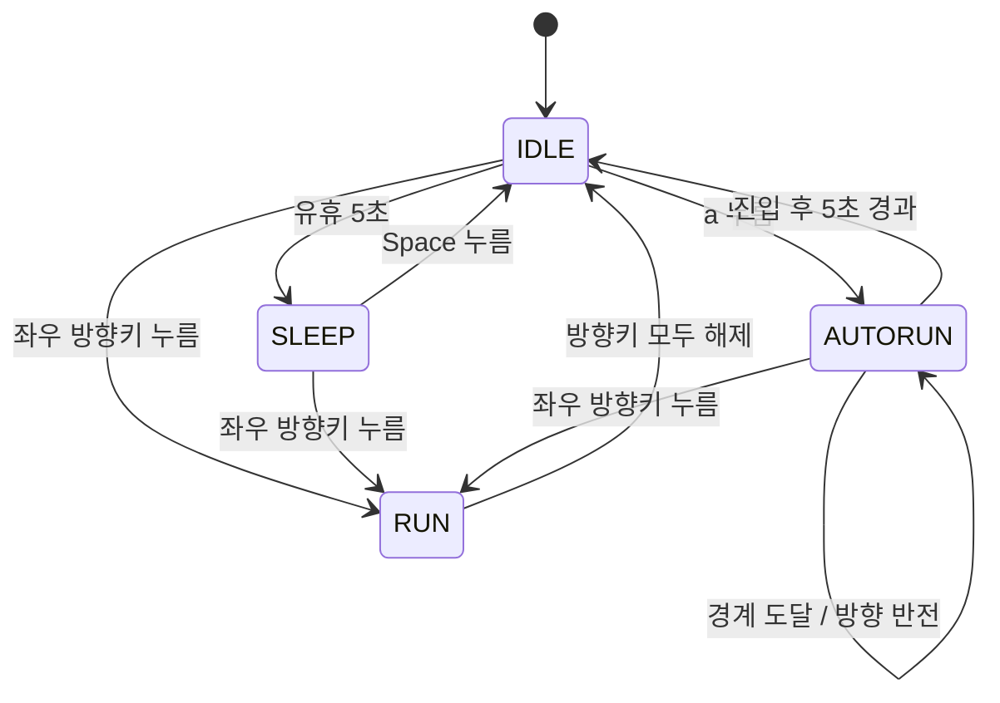

# PRD: 소년 자동 무적 런(AutoRun)

## 1. 목적

Python pico2d 기반 소년 이동 프로그램에 상태 머신을 활용한 자동 달리기 상태를 추가한다. 사용자는 IDLE 상태에서 `a` 키를 눌러 5초 동안 더 빠르고 커진 소년이 화면 양 끝에서 반사되며 이동하는 모습을 확인할 수 있다.

원본 요구사항은 `PRE-PRD.md`이며, 이 문서는 이후 구현 및 검증의 기준이다. 이번 문서 작성 단계에서는 게임 코드 수정이나 구현 커밋을 수행하지 않는다.

## 2. 현재 구현

| 항목 | 현재 동작 |
| --- | --- |
| 실행 진입점 | `main.py`에서 이벤트 처리, 업데이트, 렌더링 수행 |
| 상태 관리 | `boy.py`의 `Boy`가 `transitions.Machine`으로 IDLE, RUN, SLEEP 관리 |
| 이동 | 좌우 방향키로 RUN, 마지막으로 누른 방향키를 우선 적용 |
| 정지 | 누른 방향키가 모두 해제되면 IDLE |
| 수면 | IDLE에서 마지막 입력 이후 5초가 지나면 SLEEP |
| 기상 | SLEEP에서 Space를 누르면 IDLE, 방향키를 누르면 RUN |
| 이동 범위 | x 좌표를 0~800으로 제한 |
| 기본 표현 | 캐릭터 크기 100×100, RUN 이동량은 업데이트당 5픽셀 |

## 3. 범위

### 포함

- `boy.py`와 `main.py` 수정.
- 명시적인 `AutoRun` 상태 클래스 추가 및 기존 상태 머신과 연결.
- 자동 이동, 경계 반사, 속도 증가, 크기 확대, 5초 타임아웃 구현.
- 방향키 입력에 따른 AutoRun 취소 및 RUN 전환.
- 기존 IDLE, RUN, SLEEP 동작 유지.
- 상태 다이어그램 원본과 이미지 산출물 준비.
- 구현 단계별 검증과 한국어 메시지 커밋.

### 제외

- 적, 충돌 피해, 체력, 점수, 새로운 맵 및 이펙트 시스템.
- 기존 프로그램 전체를 새로운 상태 머신 구조로 교체하는 작업.

현재 코드에는 피해나 충돌 시스템이 없다. 따라서 이 기능에서 ‘무적’은 AutoRun 모드의 명칭이며, 피해 무효화 시스템은 추가하지 않는다.

## 4. 기능 요구사항

### FR-01. AutoRun 진입

- IDLE에서 `a` 키의 KEYDOWN 이벤트를 받으면 AUTORUN으로 전환한다.
- 진입 시 현재 바라보는 방향(`face_dir`)으로 이동을 시작한다.
- 진입 시각을 기록하고 AutoRun 전용 속도와 크기를 적용한다.
- RUN 또는 SLEEP에서 `a`를 눌러도 AutoRun에 진입하지 않는다.
- AutoRun 중 `a`를 다시 눌러도 지속 시간이 연장되거나 시작 시각이 초기화되지 않는다.

### FR-02. 자동 이동과 경계 반사

- 방향키를 누르지 않아도 매 업데이트마다 현재 방향으로 이동한다.
- 왼쪽 또는 오른쪽 경계에 도달하면 위치를 유효 범위로 보정하고 방향을 반전한다.
- 이동 방향과 달리기 애니메이션 방향이 일치해야 한다.
- 경계 처리에는 확대된 캐릭터의 반너비를 반영하여 AutoRun 중 이미지가 화면 밖으로 잘리지 않게 한다.
- IDLE에서 경계 가까이 있다가 진입한 경우에도 첫 이동 업데이트에서 유효 범위 안으로 보정한다.

### FR-03. 속도와 크기 변화

- AutoRun 속도는 일반 RUN보다 2배 빨라야 한다.
- AutoRun 렌더링 크기는 기본 크기보다 1.5배 커야 한다.
- AutoRun 중에는 기존 달리기 스프라이트를 사용한다.
- AutoRun 종료 시 속도와 크기를 즉시 기본값으로 복원한다.
- 확대해도 발 위치가 기존 지면 높이에 맞도록 렌더링 중심을 보정한다.

| 설정 | 제안값 |
| --- | --- |
| 지속 시간 | 5.0초 — 원문 필수 요구사항 |
| 속도 배율 | 일반 RUN의 2배 |
| 크기 배율 | 기본 크기의 1.5배, 즉 150×150 |
| 화면 너비 | 현재 캔버스 너비 사용, 기존 기본값 800 |
| AutoRun x 범위 | 크기 150 기준 75~725 |

현재 RUN은 프레임당 이동량을 사용한다. 이번 범위에서는 이 방식을 유지해도 되며, 시간 기반 이동을 도입한다면 RUN과 AutoRun에 일관되게 적용한다. 5초 지속 시간은 프레임 수가 아닌 실제 경과 시간으로 판정한다.

### FR-04. 시간 만료

- `time.monotonic()` 기준으로 진입 후 경과 시간이 5.0초 이상인 첫 업데이트에서 IDLE로 전환한다.
- 종료 위치와 마지막으로 바라보던 방향은 유지한다.
- IDLE 복귀 시 유휴 시간 기준을 갱신하여 즉시 SLEEP으로 전환되지 않게 한다.
- 이후 입력 없이 IDLE에서 다시 5초가 지나면 기존 규칙대로 SLEEP에 진입한다.

### FR-05. 방향키로 중단

- AutoRun 중 왼쪽 또는 오른쪽 KEYDOWN을 받으면 즉시 RUN으로 전환한다.
- 왼쪽이면 왼쪽, 오른쪽이면 오른쪽으로 일반 속도로 이동한다.
- 양쪽 방향키가 눌린 경우 기존 규칙대로 마지막으로 누른 키를 우선한다.
- 이후 키 해제 처리는 기존 RUN 규칙을 따른다. 모든 방향키가 해제되면 IDLE로 전환한다.
- AutoRun 중 방향키 KEYUP만 발생한 경우에는 AutoRun을 취소하지 않는다.
- 방향키로 중단된 뒤에는 이전 AutoRun 타이머가 다른 상태를 강제로 종료시키지 않아야 한다.

### FR-06. 기존 입력 유지

- Escape 및 창 닫기로 종료할 수 있어야 한다.
- Space 기상, 일반 이동, 정지 및 수면 동작을 유지한다.
- AutoRun 중 Space 등 기타 키는 AutoRun을 중단하지 않는다.

## 5. 상태 설계 및 구현 지침

### 상태별 책임

- `Boy`: 현재 위치, 방향, 애니메이션 및 상태 머신 소유.
- `AutoRun` 클래스: 진입 시각, 자동 이동, 경계 반사, 시간 만료 판정, 종료 시 복원 책임.
- `main.py`: 키 이벤트 전달, 눌린 방향키 추적 및 IDLE 유휴 시간 관리.

기존 `transitions.Machine`을 유지하고 AUTORUN 상태를 추가한다. `AutoRun`은 이름만 있는 빈 클래스가 아니라 진입·업데이트·종료 동작을 담당해야 한다. 기존 IDLE, RUN, SLEEP을 모두 별도 클래스로 재작성할 필요는 없다.

AutoRun의 진입 및 종료 처리는 하나의 경로로 모아 시간 만료와 방향키 취소 모두에서 속도·크기·타이머 정리가 동일하게 실행되게 한다. 이벤트 이름과 메서드 이름은 기존 코드와 충돌하지 않게 정한다.

### 전이 표

| 현재 상태 | 조건 | 다음 상태 | 처리 |
| --- | --- | --- | --- |
| IDLE | `a` KEYDOWN | AUTORUN | 진입 시각 기록, 크기·속도 변경 |
| AUTORUN | 5초 경과 | IDLE | 자동 이동 종료, 기본값 복원, 유휴 시간 갱신 |
| AUTORUN | 좌우 방향키 KEYDOWN | RUN | 기본값 복원, 입력 방향으로 이동 |
| AUTORUN | 화면 경계 도달 | AUTORUN 유지 | 위치 보정 및 방향 반전, 타이머 유지 |
| IDLE 또는 SLEEP | 좌우 방향키 KEYDOWN | RUN | 기존 이동 처리 |
| RUN | 방향키 모두 해제 | IDLE | 기존 정지 처리 |
| IDLE | 입력 없이 5초 경과 | SLEEP | 기존 수면 처리 |
| SLEEP | Space KEYDOWN | IDLE | 기존 기상 처리 |

한 루프에서 방향키 입력과 시간 만료 조건이 함께 성립하면 이벤트 처리로 RUN에 전환된 결과를 유지한다. 타임아웃은 현재 상태가 AUTORUN일 때만 평가한다.

## 6. 상태 다이어그램

단순한 상태도이므로 생성형 이미지 도구 없이 Mermaid 원본을 PNG로 렌더링하는 방식이 적합하다. 아래 정의를 구현 단계에서 `docs/state-diagram.mmd`로 저장하고, Mermaid 렌더러로 `docs/state-diagram.png`를 생성한다. 렌더링 도구 설치 가능 여부는 구현 시 확인하며, 이미지가 실제 생성되기 전에는 산출물 완료로 판정하지 않는다.

경계 반사는 상태 재진입이 아니다. 위 자기 화살표는 동작을 표현한 것이며, 실제 구현에서 진입 시각을 다시 기록해서는 안 된다.

## 7. 검증 및 인수 기준

| ID | 검증 방법 | 통과 기준 |
| --- | --- | --- |
| AC-01 | 시작 후 IDLE에서 `a` 입력 | AUTORUN으로 전환되고 키 입력 없이 이동 |
| AC-02 | 왼쪽을 바라보는 IDLE에서 `a` 입력 | 왼쪽으로 자동 이동 시작 |
| AC-03 | AutoRun을 유지하며 시간 측정 | 5초 이전에 종료되지 않고 5초 이상인 첫 업데이트에서 IDLE 복귀 |
| AC-04 | 같은 업데이트 횟수의 RUN과 비교 | AutoRun 이동량이 더 크고 제안 배율 적용 시 2배 |
| AC-05 | AutoRun 진입과 종료 모습 비교 | 진입 시 150×150, 종료 시 100×100으로 복원되고 발 위치 유지 |
| AC-06 | 양쪽 경계까지 각각 이동 | 확대된 이미지가 화면 안에 머물며 방향을 반전 |
| AC-07 | AutoRun 중 좌우 방향키 각각 입력 | 즉시 해당 방향 RUN, 기본 속도·크기 복원 |
| AC-08 | 취소 후 방향키 모두 해제 | IDLE로 전환되며 이전 타이머가 개입하지 않음 |
| AC-09 | AutoRun 중 `a` 반복 입력 및 KEYUP만 전달 | 지속 시간이 연장되거나 AutoRun이 취소되지 않음 |
| AC-10 | AutoRun 시간 만료 후 입력 없이 대기 | IDLE이 유지된 뒤 새로운 유휴 5초 경과 시 SLEEP |
| AC-11 | RUN·SLEEP에서 `a` 입력 | 현재 상태 유지, 예외 없음 |
| AC-12 | 양방향 누름 및 해제, 기상, 종료 조작 | 기존 동작 유지 |
| AC-13 | 다이어그램 파일 열기 | 원본과 이미지가 존재하고 실제 상태 전이와 일치 |

시간·경계·복원 처리는 가능하면 렌더링 없이 상태와 좌표를 검증하고, 확대 크기·애니메이션·지면 정렬은 실제 pico2d 실행으로 확인한다. GUI 검증을 실행하지 못한 경우 완료 보고에 미검증 항목을 명시한다.

## 8. 구현 및 커밋 계획

다음은 구현 작업 시 적용할 단계별 커밋 계획이다. 각 단계의 변경과 관련 검증을 마친 뒤 커밋하며, 메시지는 한국어로 작성한다. 기존 사용자 변경을 임의로 포함하거나 되돌리지 않는다.

1. **상태와 이동 구현** — `AutoRun` 클래스, 상태 전이, 자동 이동·반사·확대·시간 만료 구현. 예: `기능: 자동 달리기 상태와 경계 반사 구현`
2. **입력과 기존 기능 연결** — `a` 진입, 방향키 취소, 키 해제, 수면 타이머 연동 및 회귀 확인. 예: `기능: 자동 달리기 입력과 수면 전이 연동`
3. **검증 및 문서 마무리** — 발견된 문제 수정, 상태 다이어그램 원본·이미지와 검증 결과 정리. 예: `문서: 상태 다이어그램과 자동 달리기 검증 결과 추가`

## 9. 완료 조건

- `boy.py`와 `main.py`에 요구 동작이 구현되어 있다.
- `AutoRun` 클래스가 상태 동작을 실제로 담당한다.
- AC-01~AC-13이 통과하고 검증 결과가 기록되어 있다.
- 상태 다이어그램 원본 및 이미지가 준비되어 있다.
- 구현 변경이 단계별 한국어 메시지로 커밋되어 있다.
- 피해 판정 등 범위 밖의 시스템을 추가하지 않고 기존 기능이 유지된다.
